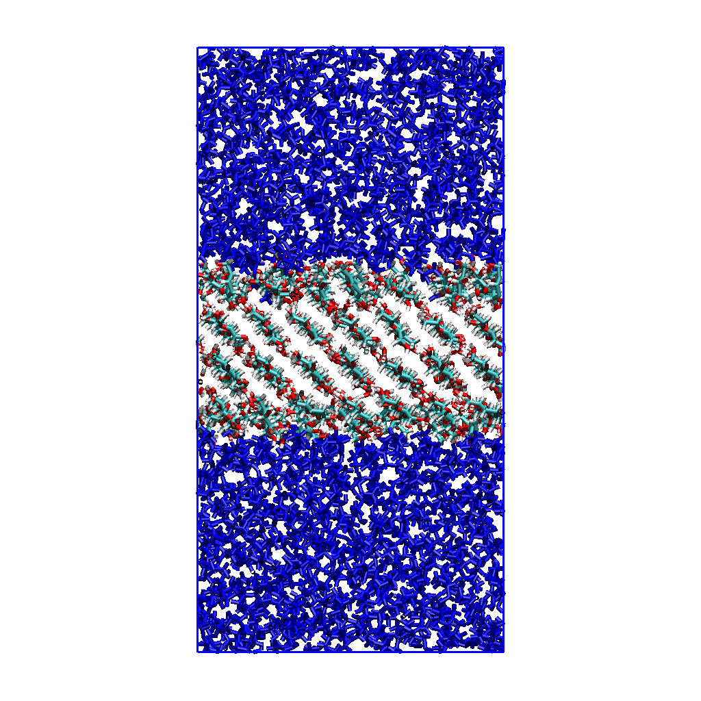

# Overview

Python workflow that builds a crystalline cellulose slab with **GLYCAM**,
parameterizes a small liquid molecule with **GAFF2/AM1-BCC** (or uses a rigid
water preset), packs the liquid on both cellulose surfaces, and writes a single
combined **GROMACS** system. **Each force field keeps its own 1–4 scaling in the
combined topology.** This is validated against Amber and OpenMM.

<p align="center">
  
  <br>
  <em>Four-layer cellulose Iβ slab (centre) interfaced with ethanol on both sides.</em>
</p>

## Key Features

- **🧱 Crystalline cellulose slabs**: GLYCAM06j-1 slabs of any allomorph, face,
  size and layer count, built through CelluloseForge 1.1.2, with periodic or
  finite chains and optional layer restraints.
- **🧪 Any small-molecule liquid from SMILES**: GAFF2 atom types and AM1-BCC
  charges via AmberTools, written as Amber and GROMACS topologies.
- **💧 Rigid water presets**: SPC, SPC/E, TIP3P, TIP4P, TIP4P-Ew and TIP5P,
  with model-specific geometry, constraints and virtual sites (see
  [Water Models](#water-models)).
- **📦 Two-sided periodic packing**: Packmol places half the liquid on each
  cellulose surface, sized from the requested density.
- **⚖️ Mixed 1–4 scaling in one topology**: GLYCAM's unit 1–4 scaling is kept
  globally, and GAFF2's scaling is written explicitly into each liquid pair.
- **✅ Validated conversion**: checked within GROMACS and against Amber and
  OpenMM, energies and forces.
- **🖥️ Cluster-ready protocols**: Slurm scripts for restrained minimization,
  fixed-area NPT, NVT production, extensions and a pure-liquid reference.

## What This Tool Does

Prepare and run a **cellulose–liquid interface** simulation in **GROMACS**, with
GLYCAM cellulose and a GAFF2 or rigid-water liquid.

**Typical workflow:**
1. Build a GLYCAM cellulose slab with CelluloseForge.
2. Parameterize the liquid molecule from SMILES, or prepare a water preset.
3. Pack the liquid on both sides of the slab.
4. Combine the cellulose and liquid topologies into one GROMACS system.
5. Run restrained minimization, fixed-area NPT, and NVT production.

**Input → Output Mapping**
- **Slab request** (allomorph, face, size, layers, restraints) → `cellulose.gro`,
  `cellulose.pdb`, `cellulose.top` and `cellulose_build_report.json`.
- **Liquid SMILES** → `.mol2`, `.frcmod`, `.prmtop`, `.inpcrd`, `.top`, `.gro`
  and `.itp` files. **Water preset name** → `water_MODEL.top`, `.pdb`, `.itp`.
- **Slab coordinates + liquid** → a packed `interface.pdb`.
- **Slab topology + liquid topology + packed coordinates** → `interface.gro`,
  `system.top`, `forcefield.itp`, `slab.itp` and `liquid.itp`.

Every command writes into `--output-directory` (default: the current
directory) under fixed names that never clash, so one directory can hold the
whole case. `--suffix` names a variant of the same case (for example
`--suffix 3000` → `interface_3000.pdb`, `system_3000.top`, ...).

Run commands from the `Cellulose_interface` project root.

## Table of Contents
- [Open Source](#open-source)
- [Citation](#citation)
- [Platform Compatibility](#platform-compatibility)
- [What You Need](#what-you-need)
- [Installation](#installation)
  - [Recommended Conda installation](#recommended-conda-installation)
  - [Verify the installation](#verify-the-installation)
- [Files](#files)
  - [MDP files](#mdp-files)
- [Command Reference](#command-reference)
- [How It Works](#how-it-works)
  - [Encoding each force field's 1–4 scaling](#encoding-each-force-fields-14-scaling)
- [Tutorial](#tutorial)
  - [1. Build the cellulose slab](#1-build-the-cellulose-slab)
  - [2. Parameterize the liquid](#2-parameterize-the-liquid)
  - [3. Pack liquid around cellulose](#3-pack-liquid-around-cellulose)
  - [4. Assemble the combined GROMACS system](#4-assemble-the-combined-gromacs-system)
  - [5. Run restrained minimization, NPT, and NVT](#5-run-restrained-minimization-npt-and-nvt)
  - [6. Check progress and equilibration](#6-check-progress-and-equilibration)
  - [Pure-ethanol reference density](#pure-ethanol-reference-density)
  - [Extending equilibration and restarting production](#extending-equilibration-and-restarting-production)
  - [Larger liquid reservoir: 1,500 ethanol molecules per surface](#larger-liquid-reservoir-1500-ethanol-molecules-per-surface)
- [Water Models](#water-models)
  - [Available presets](#available-presets)
  - [Prepare a water topology](#prepare-a-water-topology)
  - [Pack and combine a water interface](#pack-and-combine-a-water-interface)
  - [Notes](#notes)
- [Validation](#validation)
  - [GROMACS pair-conversion check (ethanol)](#gromacs-pair-conversion-check-ethanol)
  - [Independent Amber and OpenMM verification](#independent-amber-and-openmm-verification)
- [Troubleshooting](#troubleshooting)
- [Contributing](#contributing)

## Open Source

This is an open-source project, licensed under the GNU General Public License
v3.0 or later (GPL-3.0-or-later), matching CelluloseForge. See
[`LICENSE`](LICENSE).

## Citation

If you use this software in your research, please cite it as:

> Sridhar, A. S. *Cellulose_interface: cellulose–liquid interface workflow for
> GROMACS* (version 0.8.0.dev0). https://github.com/askforarun/Cellulose_interface

The same metadata is in [`CITATION.cff`](CITATION.cff); GitHub's **Cite this
repository** button exports it as APA or BibTeX.

Please also cite the software and methods the workflow relies on:

- **CelluloseForge 1.1.2**: https://github.com/askforarun/cellulose-forge, and
  the Cellulose-Builder toolkit it builds on: T. C. F. Gomes and M. S. Skaf,
  *J. Comput. Chem.* **33**, 1338–1346 (2012), doi:10.1002/jcc.22959.
- **GLYCAM06** (cellulose): K. N. Kirschner *et al.*, *J. Comput. Chem.*
  **29**, 622–655 (2008), doi:10.1002/jcc.20820.
- **GAFF** (liquid): J. Wang *et al.*, *J. Comput. Chem.* **25**, 1157–1174
  (2004), doi:10.1002/jcc.20035.
- **AM1-BCC** charges: A. Jakalian, D. B. Jack and C. I. Bayly, *J. Comput.
  Chem.* **23**, 1623–1641 (2002), doi:10.1002/jcc.10128.
- **AmberTools**: D. A. Case *et al.*, *J. Chem. Inf. Model.* **63**,
  6183–6191 (2023), doi:10.1021/acs.jcim.3c01153.
- **Packmol**: L. Martínez *et al.*, *J. Comput. Chem.* **30**, 2157–2164
  (2009), doi:10.1002/jcc.21224.
- **Open Babel**: N. M. O'Boyle *et al.*, *J. Cheminform.* **3**, 33 (2011),
  doi:10.1186/1758-2946-3-33.
- **GROMACS**: M. J. Abraham *et al.*, *SoftwareX* **1–2**, 19–25 (2015),
  doi:10.1016/j.softx.2015.06.001.

If you use a water preset, also cite the original publication of that model.

## Platform Compatibility

Used on:
- **macOS** (Apple Silicon) for building, parameterization, packing and topology preparation;
- **Linux** (Slurm cluster, GROMACS 2026.1 CUDA build) for simulation.

## What You Need

- **Python** 3.11 or newer.
- **[CelluloseForge 1.1.2](https://github.com/askforarun/cellulose-forge/releases/tag/v1.1.2)**,
  which provides the `cellulose-forge` command.
- **AmberTools**: `antechamber`, `parmchk2`, `tleap`, and the GLYCAM parameter
  files.
- **ParmEd**, importable by the Python interpreter used for parameterization.
- **Open Babel** (`obabel`) and **Packmol** (`packmol`) on `PATH`. Packmol must
  support the `pbc` input keyword.
- **GROMACS** for preprocessing and simulation; **Slurm** for the supplied
  batch scripts.

## Installation

### Recommended Conda installation

Install CelluloseForge 1.1.2 first. Its environment supplies Python, NumPy,
AmberTools (`antechamber`, `parmchk2`, and `tleap`), ParmEd, and
CelluloseForge itself:

```bash
git clone --branch v1.1.2 --depth 1 https://github.com/askforarun/cellulose-forge.git ../cellulose_forge
(cd ../cellulose_forge && conda env create --file environment.yml)
conda activate cellulose-forge
```

Then, from the `Cellulose_interface` project root, add only the dependencies
specific to this interface workflow. This repository's `environment.yml` is
an overlay: it adds Open Babel, Packmol, GROMACS, and the interface command-line
tools without redeclaring the packages supplied by CelluloseForge.

```bash
conda env update --name cellulose-forge --file environment.yml
conda activate cellulose-forge
```

Packmol is installed from its official PyPI distribution because the
conda-forge AmberTools package intentionally conflicts with conda-forge's
Packmol package.

The supplied Slurm scripts use a cluster-provided `gmx_mpi` module and Slurm;
those site-specific tools are intentionally not installed by this local Conda
environment.

### Verify the installation

```bash
python --version
cellulose-forge --version
antechamber -h >/dev/null
parmchk2 -h >/dev/null
tleap -h >/dev/null
obabel -V
packmol --version
gmx --version
```

`build_cellulose_slab.py` runs `cellulose-forge` from your `PATH`. Pass
`--cellulose-forge-executable /path/to/cellulose-forge` if it is installed
elsewhere.

The installed command names are `build-cellulose-slab`,
`parameterize-molecule`, `prepare-water-model`, `pack-liquid-cellulose`, and
`combine-gromacs-topologies`. The Python files can also be run directly.

## Files

| File or directory | Purpose |
| --- | --- |
| `build_cellulose_slab.py` | Call the installed `cellulose-forge` command (CelluloseForge 1.1.2) to generate the slab and its topology |
| `parameterize_molecule.py` | Generate GAFF2/AM1-BCC small-molecule parameters using AmberTools and ParmEd |
| `prepare_water_model.py` | Write a rigid water-model template and standalone GROMACS topology |
| `pack_liquid_cellulose.py` | Use Packmol to place liquid on both sides of the cellulose slab |
| `combine_gromacs_topologies.py` | Combine topologies and convert packed coordinates to GROMACS format |
| `pyproject.toml` | Package metadata and optional installed command-line tools |
| `cellulose_ethanol/` | Existing ethanol/cellulose inputs, MDP templates, and pair-validation artifacts |
| `cellulose_ethanol/run_restrained.sbatch` | Cluster submission script; all ethanol simulation inputs and outputs live directly in `cellulose_ethanol/` |

### MDP files

GROMACS parameter files supplied in `cellulose_ethanol/`:

| File | Used by | Purpose |
| --- | --- | --- |
| `em.mdp` | `run_restrained.sbatch` | Steepest-descent minimization |
| `npt.mdp` | `run_restrained.sbatch` | 500 ps NPT, 298.15 K, 1 bar; X/Y fixed, Z free |
| `nvt_production.mdp` | `run_restrained.sbatch` | 2 ns NVT production |
| `nvt_production_extended.mdp` | `extend_interface.sbatch` | Fresh 2 ns NVT after the extended NPT (2.5–4.5 ns) |
| `em_3000.mdp` | `run_interface_3000.sbatch` | Minimization of the 3,000-ethanol system |
| `npt_3000.mdp` | `run_interface_3000.sbatch` | 2.5 ns NPT of the 3,000-ethanol system; X/Y fixed, Z free |
| `pure_ethanol/em.mdp` | `run_pure_ethanol.sbatch` | Minimization of the pure-ethanol box |
| `pure_ethanol/npt_equil.mdp` | `run_pure_ethanol.sbatch` | 1 ns isotropic NPT equilibration |
| `pure_ethanol/npt_sample.mdp` | `run_pure_ethanol.sbatch` | 2 ns NPT density sampling |
| `ethanol_pair_validation/single_point.mdp` | `validate_explicit_pairs.py` | Single-point energy for the GROMACS pair-conversion check |
| `topology_check.mdp` | manual use | Zero-step PME single point for checking a combined topology with `grompp` and `mdrun` |

The interface files (`em`, `npt`, `nvt_production`, their `_3000` and extended
versions) set `define = -DPOSRES_CELLULOSE`. They restrain the selected layers
for a slab built with `--restrain-layers`, and work unchanged, with no
restraints, for a slab built with `--no-restraints`. The pure-ethanol files
apply no restraints.

## Command Reference

Every command also accepts `--version` and `-h, --help`. Lengths are in **Å**
unless stated otherwise; GROMACS box dimensions are in **nm**.

### `build_cellulose_slab.py`

| Argument | Required | Description |
|-----------|----------|-------------|
| `--layers` | yes | Number of molecular layers in the slab |
| `--width` | yes | Slab width (Å); rounded to fit the crystal lattice |
| `--length` | yes | Slab length along the chains (Å); rounded to fit the lattice |
| `--allomorph` | optional | Cellulose allomorph. Default: `I-beta` |
| `--face` | optional | Miller index `H K L` of the exposed face. Default: `1 1 0` |
| `--chain-boundary` | optional | `periodic` or `finite` chains. Default: `periodic` |
| `--vacuum` | optional | Vacuum padding (Å). Default: `0` |
| `--padding-longitudinal` | optional | Total chain-axis padding (Å) for finite chains, for example `12` |
| `--force-field` | optional | `glycam`, `charmm36` or `none`. Default: `glycam` |
| `--restrain-layers` or `--no-restraints` | yes (one) | Layer numbers whose heavy atoms get position restraints, or build an unrestrained slab |
| `--restraint-force` | optional | Restraint force constants `FX FY FZ` (kJ/mol/nm²), with `--restrain-layers` only. Default: `1000 1000 1000` |
| `--cellulose-forge-executable` | optional | `cellulose-forge` command or path. Default: `cellulose-forge` on `PATH` |
| `--tleap-executable` | optional | Path to `tleap` |
| `--parmed-python` | optional | Python interpreter with ParmEd |
| `--output-directory` | optional | Directory for `cellulose.gro`, `cellulose.pdb`, `cellulose.top` and `cellulose_build_report.json`. Default: current directory |
| `--dry-run` | optional | Print the CelluloseForge command without running it |

### `parameterize_molecule.py`

| Argument | Required | Description |
|-----------|----------|-------------|
| `--smiles` | yes | Molecule SMILES, for example `CCO` |
| `--residue-name` | optional | 1–3 character residue name. Default: `MOL` |
| `--net-charge` | optional | Net molecular charge for AM1-BCC. Default: `0` |
| `--prefix` | optional | Output file prefix. Default: `molecule` |
| `--output-directory` | optional | Output directory. Default: current directory |
| `--obabel`, `--antechamber`, `--parmchk2`, `--tleap` | optional | Executable names or paths. Defaults: found on `PATH` |

### `prepare_water_model.py`

| Argument | Required | Description |
|-----------|----------|-------------|
| `--model` | yes | `spc`, `spce`, `tip3p`, `tip4p`, `tip4pew` or `tip5p` |
| `--prefix` | optional | Output prefix. Default: `water_MODEL` |
| `--output-directory` | optional | Output directory. Default: current directory |

### `pack_liquid_cellulose.py`

| Argument | Required | Description |
|-----------|----------|-------------|
| `--cellulose-coordinates` | yes | Slab coordinates (`.gro` or `.pdb`) |
| `--smiles` or `--water-model` | yes (one) | Molecular liquid SMILES, or a rigid water preset |
| `--molecules` | yes | Total liquid molecules; must be even (half per surface) |
| `--density` | yes | Initial packing density (g/cm³) |
| `--residue-name` | optional | Liquid residue name. Default: `MOL`; water presets use `SOL` |
| `--output-directory` | optional | Directory for the packed `interface.pdb`. Default: current directory |
| `--suffix` | optional | Case suffix: writes `interface_SUFFIX.pdb` |
| `--tolerance-angstrom` | optional | Packmol tolerance (Å). Default: `2.0` |
| `--maxit`, `--nloop` | optional | Packmol iteration settings. Defaults: `50`, `5` |
| `--max-attempts` | optional | Packing attempts before failing. Default: `5` |
| `--z-growth-factor` | optional | Factor by which Z grows after a failed attempt. Default: `1.05` |
| `--seed` | optional | Packmol seed. Default: `1234567` |
| `--packmol`, `--obabel` | optional | Executable names or paths. Defaults: found on `PATH` |
| `--dry-run` | optional | Print the box calculation without packing |

### `combine_gromacs_topologies.py`

| Argument | Required | Description |
|-----------|----------|-------------|
| `--slab` | yes | Cellulose (GLYCAM) topology |
| `--liquid` | yes | Native liquid or water topology |
| `--output-directory` | optional | Directory for `interface.gro`, `system.top`, `forcefield.itp`, `slab.itp` and `liquid.itp`. Default: current directory |
| `--suffix` | optional | Case suffix: writes `interface_SUFFIX.gro`, `system_SUFFIX.top`, `forcefield_SUFFIX.itp`, `slab_SUFFIX.itp`, `liquid_SUFFIX.itp`, with matching includes |
| `--combined-coordinates` | one of | Packed coordinates with slab atoms first; the liquid count is inferred |
| `--slab-coordinates` + `--liquid-coordinates` | one of | Separate boxes to be assembled instead |
| `--axis` | optional | Stacking axis when assembling separate boxes. Default: `z` |
| `--interface-gap` | optional | Gap at each periodic interface (nm) when assembling. Default: `0.0` |
| `--coordinate-layout` | optional | `centered-slab` or `stacked` when assembling. Default: `centered-slab` |
| `--system-name` | optional | `[ system ]` title. Default: `Combined molecular system` |

## How It Works

1. **Slab.** `build_cellulose_slab.py` forwards the request to CelluloseForge,
   which builds the slab and its GLYCAM topology with tleap and ParmEd, with
   global 1–4 scaling of 1.0. Cellulose dimensions are rounded to fit the
   crystal lattice.
2. **Liquid parameters.** `parameterize_molecule.py` generates 3D coordinates
   with Open Babel, assigns GAFF2 types and AM1-BCC charges with antechamber,
   adds missing parameters with parmchk2, and builds Amber and GROMACS
   topologies with tleap and ParmEd.
3. **Packing.** `pack_liquid_cellulose.py` keeps the cellulose X/Y box lengths
   and centres the slab along Z. It places half the liquid on each surface. The
   initial Z length comes from the liquid mass, target density, lateral area
   and slab thickness; each failed attempt enlarges Z, so the initial density
   can end up below the target.
4. **Combination.** `combine_gromacs_topologies.py` keeps the slab's global
   defaults and writes the liquid's own 1–4 scaling into explicit type-2 pairs
   (see below). It requires matching nonbonded functions and combination rules,
   and rejects conflicting atom-type Lennard-Jones parameters. Any small
   printed-charge residual (at most 10⁻⁴ e) is moved onto each molecule's last
   atom, so every molecule is exactly integer-charged.
5. **Simulation.** The Slurm scripts run restrained minimization, NPT with
   fixed X/Y and free Z, and NVT production. Restraints are switched on with
   `define = -DPOSRES_CELLULOSE`. A slab built with `--no-restraints` uses the
   same MDP files and runs without restraints.

### Encoding each force field's 1–4 scaling

A 1–4 pair consists of atoms separated by three bonds. Its Lennard-Jones and electrostatic interactions can use force-field-specific scaling. Simply combining two molecule topologies under one set of GROMACS `[ defaults ]` can therefore change the liquid's intramolecular energy.

For this workflow, the scaling conventions are:

| Component | Lennard-Jones 1–4 multiplier | Electrostatic 1–4 multiplier |
| --- | --- | --- |
| GLYCAM cellulose | 1.0 | 1.0 |
| GAFF2 liquid generated by this parameterizer | 0.5 | approximately 0.83333333 |

GROMACS uses one set of global 1–4 scaling factors for the combined system, but GLYCAM and GAFF2 require different values. We keep the global factors at **1.0 for GLYCAM** and specify GAFF2’s scaling directly for each liquid 1–4 pair: **0.5 for Lennard-Jones** and **1/1.2 for electrostatics**. This lets both force fields retain their original 1–4 interactions within the same simulation.

`combine_gromacs_topologies.py` handles this automatically:

1. Retain the slab topology's global defaults, including GLYCAM's unit scaling.
2. Read the liquid topology's native scaling factors, atom charges, and atom-type Lennard-Jones parameters.
3. Convert each liquid type-1 `[ pairs ]` entry into an explicit type-2 entry with fields `ai aj funct fudgeQQ qi qj sigma14 epsilon14`.
4. Encode electrostatic scaling in the pair's `fudgeQQ` field and Lennard-Jones scaling in `epsilon14`.

For the supported combination rule 2, the converter uses:

```text
sigma14   = (sigma_i + sigma_j) / 2
epsilon14 = sqrt(epsilon_i * epsilon_j) * liquid_fudgeLJ
pair_fudgeQQ = liquid_fudgeQQ
```

Although the global scaling factors are set to 1.0 for GLYCAM, the liquid retains its original force-field-specific 1–4 scaling because those factors are specified directly for each liquid 1–4 pair. These per-pair scaling settings apply to intramolecular 1–4 interactions; it does not introduce a separate scaling factor for cellulose–liquid interactions. `parameterize_molecule.py` also writes an explicit-pair molecule ITP, but the combiner should receive the native liquid `.top` so that it can read its original defaults and type-1 pairs. Do not apply the conversion twice.

The current converter supports combination rule 2 and ordinary three-field type-1 liquid pair rows. It rejects other pair formats rather than assuming their meaning. Review the source force-field conventions when introducing another liquid or topology source.

The conversion is validated twice: within GROMACS for the liquid, and against Amber and OpenMM for the
complete combined topology. See [Validation](#validation).

## Tutorial

The worked example is a **cellulose I-beta (110)–ethanol interface**, with
**GLYCAM06j-1 for cellulose** (`leaprc.GLYCAM_06j-1`) and **GAFF2/AM1-BCC for
ethanol**. The cellulose builder defaults to `glycam`, and the build command
below explicitly selects it. The liquid parameterization script generates
GAFF2 parameters; it does not parameterize cellulose. The checked-in I-beta
`(110)` example was built with CelluloseForge 1.1.2.

### 1. Build the cellulose slab

Example: four layers, approximately 40 Å wide and 40 Å long, with periodic cellulose chains and restraints on layers 2 and 3.

```bash
# Restraints: keep --restrain-layers and --restraint-force to restrain layers 2
# and 3, or replace both lines with --no-restraints (example below).
python build_cellulose_slab.py \
  --allomorph I-beta \
  --face 1 1 0 \
  --layers 4 \
  --width 40 \
  --length 40 \
  --chain-boundary periodic \
  --vacuum 0 \
  --force-field glycam \
  --restrain-layers 2 3 \
  --restraint-force 1000 1000 1000 \
  --output-directory cellulose_ethanol
```

Choose restraints explicitly: pass either `--restrain-layers` or
`--no-restraints`. For a fully unrestrained slab, replace the two restraint
lines with `--no-restraints`:

```bash
python build_cellulose_slab.py \
  --allomorph I-beta \
  --face 1 1 0 \
  --layers 4 \
  --width 40 \
  --length 40 \
  --chain-boundary periodic \
  --vacuum 0 \
  --force-field glycam \
  --no-restraints \
  --output-directory cellulose_ethanol
```

With `--no-restraints`, the topology has no position restraints. The builder
adds an empty `#ifdef POSRES_CELLULOSE … #endif` block, so the supplied MDP files
and batch scripts, which define `POSRES_CELLULOSE`, run unchanged and apply no
restraints. An unrestrained slab can drift as a whole along Z, so center on the
cellulose when analyzing profiles.

If needed, also pass `--cellulose-forge-executable /path/to/cellulose-forge`, `--tleap-executable /path/to/tleap`, or `--parmed-python /path/to/python`.

For a finite-chain build, also pass `--padding-longitudinal 12` or a larger
application-appropriate value. The option is included in `--dry-run` output,
so the exact CelluloseForge request remains inspectable. Periodic chains use
zero longitudinal padding.

The builder runs CelluloseForge in a temporary `.cellulose_forge_build`
directory inside `--output-directory`. It then writes `cellulose.gro`,
`cellulose.pdb`, `cellulose.top` and `cellulose_build_report.json` there, and
the report's `outputs` names those files. The `cellulose.*` names never clash
with the combined system written in step 4, so the whole case can live in one
directory. The slab files are liquid-independent and can be reused for
ethanol, water, or another compatible liquid. Cellulose dimensions are rounded
to fit the crystal lattice. Review the generated build report for
realized dimensions, chain ordering, periodic connectivity, and restrained
layers. The existing example has 32 chains (eight per layer), eight glucose
units per chain, and 5,376 cellulose atoms, in a 4.7716 × 4.1520 nm lateral box.

`--dry-run` prints the CelluloseForge command, but still requires `cellulose-forge` to be installed.

### 2. Parameterize the liquid

For neutral ethanol, use SMILES `CCO` and residue name `ETO`:

```bash
python parameterize_molecule.py \
  --smiles 'CCO' \
  --residue-name ETO \
  --net-charge 0 \
  --prefix ethanol \
  --output-directory cellulose_ethanol
```

This generates `ethanol.pdb`, `.mol2`, `.frcmod`, `.prmtop`, `.inpcrd`, `.top`, `.gro`, `.itp`, and `ethanol_atomtypes.itp` in `cellulose_ethanol/`.

Use `ethanol.top` as the liquid topology when combining systems. The `.itp` molecule file separately encodes explicit type-2 1–4 interactions. The script uses GAFF2 atom types and AM1-BCC charges.

### 3. Pack liquid around cellulose

```bash
python pack_liquid_cellulose.py \
  --cellulose-coordinates cellulose_ethanol/cellulose.gro \
  --smiles 'CCO' \
  --residue-name ETO \
  --molecules 1000 \
  --density 0.789 \
  --seed 1234567 \
  --output-directory cellulose_ethanol
```

Density is in **g/cm³**; `0.789` is an example packing target. Width, length, and Packmol tolerance arguments are in **Å**, while GROMACS box dimensions printed by the packing script are in **nm**.

The script retains the cellulose X/Y box lengths, centers the slab along Z, and places half the liquid molecules on each surface. The molecule count must therefore be even. Use the same SMILES and residue name as in parameterization so atom naming and molecule identification remain consistent.

The initial Z length is calculated from the liquid mass, target density, lateral area, and slab thickness. Failed packing attempts increase the total Z dimension; the resulting initial liquid density can therefore be lower than the requested target. Packing density is an initial construction parameter, not a measurement of equilibrated bulk density.

Useful options include `--tolerance-angstrom 2.0`, `--max-attempts 5`, and `--z-growth-factor 1.05`. `--dry-run` prints the initial box calculation without packing. Open Babel is required for SMILES liquids, but not for a `--water-model` preset.

### 4. Assemble the combined GROMACS system

```bash
python combine_gromacs_topologies.py \
  --slab cellulose_ethanol/cellulose.top \
  --liquid cellulose_ethanol/ethanol.top \
  --combined-coordinates cellulose_ethanol/interface.pdb \
  --output-directory cellulose_ethanol \
  --system-name 'Cellulose I-beta ethanol interface'
```

After steps 1–4 the case directory contains:

```text
cellulose_ethanol/
├── cellulose.gro, cellulose.pdb, cellulose.top, cellulose_build_report.json   (step 1)
├── ethanol.mol2, ethanol.top, ethanol.itp, ...                                (step 2)
├── interface.pdb                                                              (step 3)
└── interface.gro, system.top, forcefield.itp, slab.itp, liquid.itp            (step 4)
```

Keep the five step-4 files together; they are the simulation inputs. The packed coordinates must list cellulose atoms first, followed by liquid molecules, with a liquid residue name matching the liquid topology. The packing script produces that ordering. Only orthorhombic boxes are supported by this workflow.

Use the GLYCAM cellulose topology as `--slab` and the molecular-liquid or
water topology as `--liquid`. The combiner retains the slab's global 1–4
scaling (`fudgeLJ = 1`, `fudgeQQ = 1`) and writes the GAFF2 liquid molecule's
scaling explicitly into its pairs (see
[Encoding each force field's 1–4 scaling](#encoding-each-force-fields-14-scaling)).
Inspect any warnings from GROMACS preprocessing rather than bypassing them
automatically.

The provided example already has these five files directly in `cellulose_ethanol/`. Rebuilding with the commands above replaces the final interface inputs there; run construction only when no simulation is using those files.

### 5. Run restrained minimization, NPT, and NVT

The batch script currently follows this sequence:

| Stage | Settings |
| --- | --- |
| Minimization | Steepest descent, maximum 50,000 steps, force tolerance 500 kJ/mol/nm |
| NPT | 500 ps, 2 fs timestep, 298.15 K, semi-isotropic C-rescale pressure coupling at 1 bar; X/Y fixed and Z free to relax |
| NVT production | 2 ns, 2 fs timestep, 298.15 K; final NPT box and velocities retained |

All stages use `periodic-molecules = yes` and `define = -DPOSRES_CELLULOSE`, which activates the middle-layer heavy-atom restraints in this example. A generic `-DPOSRES` does not activate this topology's restraints.

Fixed lateral area during NPT is implemented with:

```ini
pcoupltype      = semiisotropic
compressibility = 0.0 4.5e-5
refcoord-scaling = all
```

Semi-isotropic coupling alone allows X and Y to change together; the zero first compressibility fixes them. NVT uses the final instantaneous NPT box. Its restraint reference is reset to the final NPT cellulose coordinates.

**Submit the ethanol system.** All ethanol inputs, MDP files, submission script, and simulation outputs live directly in `cellulose_ethanol/`. Shared Python tools and package metadata stay in the project root.

```bash
cd cellulose_ethanol
sbatch run_restrained.sbatch
```

The script uses the `interface.gro`, `system.top`, included ITP files, and MDP files in this directory. It runs minimization, 500 ps fixed-X/Y NPT, and 2 ns restrained NVT in sequence. No separate run directory is created. To change the production duration before a fresh run, edit `nsteps` in `nvt_production.mdp`: at 2 fs, 1,000,000 steps is 2 ns.

The construction commands above write the five final interface files directly into `cellulose_ethanol/`, ready for submission. Do not overwrite inputs while a job is running. Existing TPRs and checkpoints are reused on resubmission; changed settings require fresh stage outputs rather than reusing old TPRs.

The cluster script uses `flight`, the `gridware` environment, module `apps/gromacs_cuda/2026.1`, and `gmx_mpi`, with one MPI process and 32 OpenMP threads. Its Slurm `--chdir` points to this checkout's `cellulose_ethanol/` directory; update this and the partition/resources when moving the project to another location or cluster.

Resubmit to resume available checkpoints. Completed stages are skipped when their final `.gro` file exists. Do not submit concurrent jobs into this directory.

### 6. Check progress and equilibration

```bash
squeue -u "$USER"
tail -n 40 cellulose_ethanol/npt.log
tail -n 40 cellulose_ethanol/nvt_production.log
```

Each stage writes its own log and energy file; dynamics also writes compressed trajectories and checkpoints. A final `.gro` indicates that the stage returned its final coordinates. Inspect minimization's actual convergence message, not only file existence.

Use `gmx energy` (or `gmx_mpi energy`) to inspect temperature, potential energy, pressure, and box lengths from `npt.edr` and `nvt_production.edr`. X and Y should remain fixed throughout this NPT protocol. Check Z relaxation, cellulose structure, and the ethanol mass-density profile along Z before judging equilibration. The current batch script advances automatically after 500 ps; it does not decide whether equilibration has been achieved.

### Pure-ethanol reference density

A separate bulk-liquid calculation lives in `cellulose_ethanol/pure_ethanol/`. It contains 1,000 ethanol molecules (9,000 atoms), with the same GAFF2/AM1-BCC parameters and charge-rounding correction as the interface liquid. Its standalone topology uses native GAFF2 type-1 pairs and global scaling of 0.5 for LJ-14 and 0.83333333 for Coulomb-14. There is no cellulose and no position restraint.

```bash
cd cellulose_ethanol/pure_ethanol
sbatch run_pure_ethanol.sbatch
```

The job inserts the molecules into a 5.1 nm cubic starting box, verifies the atom count, minimizes, runs 1 ns of initial NPT equilibration, and then runs a separate 2 ns NPT sampling stage. Both NPT stages use isotropic C-rescale coupling at 1 bar and V-rescale temperature coupling at 298.15 K, with a 2 fs timestep and hydrogen-bond constraints. All three box lengths can relax together; fixed lateral dimensions are specific to the cellulose interface, not this bulk reference.

At completion, `density.xvg` records the sampling-stage density versus time. `density_summary.txt` contains the GROMACS average, block-based error estimate, RMSD, and drift for that stage. Density is reported in kg/m³; divide by 1,000 to obtain g/cm³. `equilibration_observables.xvg` and `sampling_observables.xvg`, with their corresponding summary files, provide density, temperature, pressure, and volume for the two stages. The sampling-stage time axis starts at 1,000 ps and ends at 3,000 ps. These analysis files are generated by the job and are not tracked in the repository.

These durations are initial choices, not an automatic convergence guarantee. Inspect density and volume traces and compare averages over successive time blocks. If they are still drifting, extend equilibration and exclude the transient period from the density estimate. Compare a stable bulk reference with the ethanol density plateau away from cellulose surfaces, using matching temperature, force field, and nonbonded settings. The model's density should be measured rather than forced to equal the initial packing target.

### Extending equilibration and restarting production

Keep the existing results and continue from saved NPT checkpoints:

```bash
cd cellulose_ethanol
sbatch extend_interface.sbatch
cd pure_ethanol
sbatch extend_pure_ethanol.sbatch
```

- **Interface:** `extend_interface.sbatch` extends the original restrained NPT by 2 ns, giving 2.5 ns total NPT, with X/Y fixed and Z free to relax. It then runs a fresh 2 ns restrained NVT segment, with time axis 2.5–4.5 ns, from the extended NPT coordinates and velocities. The NVT restraint reference is reset to the final NPT geometry.
- **Pure liquid:** `extend_pure_ethanol.sbatch` adds 5 ns to the original NPT calculation, giving 8 ns total including initial equilibration. It extracts the density over 7–8 ns to `extended_last1ns_density.xvg` and `extended_last1ns_density_summary.txt`, and writes density/temperature/pressure/volume for the continuation to `extended_observables.xvg`.

Both scripts use `gmx convert-tpr -extend` and checkpoint continuation to preserve the original NPT parameters. The interface continuation therefore retains the original scaled restraint reference, rather than replacing it at the start of the NPT extension. New NPT outputs use the `npt_extended` prefix and GROMACS part numbers; the original outputs remain intact. New interface NVT outputs use `nvt_production_extended`. Do not run multiple continuation jobs in the same directory at once.

The extra durations do not guarantee equilibration. Review late-time density/volume for the pure liquid and Z/Pzz for the interface, along with profiles in successive time windows. The interface script advances automatically to NVT; treat that segment as production only after these checks support equilibration.

### Larger liquid reservoir: 1,500 ethanol molecules per surface

The larger-reservoir comparison contains **3,000 ethanol molecules total**, with 1,500 initially packed on each cellulose surface. It retains the original GLYCAM cellulose slab and the same GAFF2/AM1-BCC ethanol parameters, including the per-pair 1–4 scaling representation. The generated slab and liquid molecule ITPs were checked to be byte-identical to those of the original interface.

All case files remain directly in `cellulose_ethanol/` and use `_3000` names, preserving the previous simulations. The initial box is approximately **4.7716 × 4.1520 × 17.3879 nm**, with an initial geometric liquid thickness of **7.61 nm per face**. Packing used the simulated pure-liquid density of **0.761501 g/cm³** (7–8 ns average of the extended pure-ethanol NPT run) as an initial density target, not a constraint on the final NPT density. `interface_3000_build_report.json` records the construction checks, including 32,376 total atoms and 1,500 liquid molecules per face.

Packing and combining commands from the project root (activate an environment with Open Babel and Packmol, or provide their executable paths). `--suffix 3000` gives every file the `_3000` name:

```bash
python pack_liquid_cellulose.py \
  --cellulose-coordinates cellulose_ethanol/cellulose.gro \
  --smiles CCO --residue-name ETO \
  --molecules 3000 --density 0.761501 \
  --seed 20261016 --maxit 200 --nloop 20 \
  --output-directory cellulose_ethanol --suffix 3000

python combine_gromacs_topologies.py \
  --slab cellulose_ethanol/cellulose.top \
  --liquid cellulose_ethanol/ethanol.top \
  --combined-coordinates cellulose_ethanol/interface_3000.pdb \
  --output-directory cellulose_ethanol --suffix 3000 \
  --system-name 'Cellulose I-beta ethanol interface: 1500 ethanol molecules per face'
```

The assembled starting files are `interface_3000.gro`, `system_3000.top`, `forcefield_3000.itp`, `slab_3000.itp`, and `liquid_3000.itp`. The combined topology uses the same cellulose molecule counts as before and `ETO 3000`; its include paths refer to the case-specific ITP filenames.

```bash
cd cellulose_ethanol
sbatch run_interface_3000.sbatch
```

This job runs restrained steepest-descent minimization followed by **2.5 ns NPT** at 298.15 K and 1 bar. It uses C-rescale semi-isotropic pressure coupling with `compressibility = 0.0 4.5e-5`, keeping X/Y fixed while Z relaxes. Middle-layer heavy-atom position restraints remain enabled with `POSRES_CELLULOSE`. Output prefixes are `em_3000` and `npt_3000`. This job stops after NPT; it does not automatically launch NVT. Compare late-time liquid density profiles with the smaller reservoir and pure-liquid reference before deciding the next stage.

## Water Models

Water must not be parameterized from the SMILES `O`. Use a model-specific
geometry, charges, Lennard-Jones parameters, constraints, and virtual sites.
The workflow provides these AMBER-family GROMACS presets:

- `spc`
- `spce`
- `tip3p`
- `tip4p`
- `tip4pew`
- `tip5p`

### Available presets

Values as written by `water_models.py`. All models are rigid (`[ settles ]`),
and the hydrogens carry no Lennard-Jones parameters.

| Preset | Sites | Charges (e): O, H, virtual site | O–H (nm) | H–O–H (°) | Virtual site | O σ (nm), ε (kJ/mol) |
| --- | --- | --- | --- | --- | --- | --- |
| `spc` | 3 | −0.82, +0.41 | 0.1000 | 109.47 | — | 0.316557, 0.650629 |
| `spce` | 3 | −0.8476, +0.4238 | 0.1000 | 109.47 | — | 0.316557, 0.650629 |
| `tip3p` | 3 | −0.834, +0.417 | 0.09572 | 104.52 | — | 0.315061, 0.636386 |
| `tip4p` | 4 | 0, +0.52, −1.04 | 0.09572 | 104.52 | M, 0.0150 nm from O | 0.315365, 0.648520 |
| `tip4pew` | 4 | 0, +0.52422, −1.04844 | 0.09572 | 104.52 | M, 0.0125 nm from O | 0.316435, 0.680946 |
| `tip5p` | 5 | 0, +0.241, −0.241 (each) | 0.09572 | 104.52 | two lone pairs, 0.070 nm from O | 0.312000, 0.669440 |

### Prepare a water topology

Prepare the chosen topology and inspectable single-water template, for example:

```bash
python prepare_water_model.py \
  --model tip4pew \
  --output-directory cellulose_water
```

This writes `water_tip4pew.top`, `water_tip4pew.pdb`,
`water_tip4pew.itp`, and `water_tip4pew_atomtypes.itp`.

### Pack and combine a water interface

Pack the same model on both surfaces of the slab built in step 1 (no rebuild
needed) without Open Babel:

```bash
python pack_liquid_cellulose.py \
  --cellulose-coordinates cellulose_ethanol/cellulose.gro \
  --water-model tip4pew \
  --molecules 3000 \
  --density 0.997 \
  --output-directory cellulose_water
```

Then combine it using the generated standalone water topology:

```bash
python combine_gromacs_topologies.py \
  --slab cellulose_ethanol/cellulose.top \
  --liquid cellulose_water/water_tip4pew.top \
  --combined-coordinates cellulose_water/interface.pdb \
  --output-directory cellulose_water \
  --system-name 'Cellulose I-beta TIP4P-Ew water interface'
```

### Notes

The model definitions follow the AMBER-family files distributed with GROMACS.
TIP4P, TIP4P-Ew, and TIP5P include their required massless virtual sites. These
presets are fixed-charge rigid models; they do not imply support for arbitrary
polarizable or many-body water models. The density is still a user-selected
initial packing target and should be appropriate for the model, temperature,
and pressure being simulated.

## Validation

Two checks confirm that the combined GROMACS topology keeps each force field's
1–4 interactions. The first compares the liquid's native and explicit-pair
representations within GROMACS. The second compares the complete combined
topology, cellulose and liquid together, against Amber and OpenMM.

### GROMACS pair-conversion check (ethanol)

Validate the conversion with an isolated molecule before relying on a new force-field combination. This method applies to any supported liquid:

1. Prepare a native topology with its original global scaling and type-1 pairs.
2. Prepare an equivalent topology with the host's global defaults and explicit type-2 liquid pairs.
3. Use identical coordinates, periodic box, nonbonded settings, and GROMACS version for both single-point evaluations.
4. Compare bond, angle, proper-dihedral, LJ-14, Coulomb-14, and total potential energies. They should agree within a specified numerical tolerance.
5. Retain the settings and a machine-readable report of the energies, differences, tolerance, and pass/fail result.

The worked example in this repository is a **cellulose–ethanol interface**, using GLYCAM for cellulose and GAFF2/AM1-BCC for ethanol. The accompanying test in [`cellulose_ethanol/ethanol_pair_validation/`](cellulose_ethanol/ethanol_pair_validation/) checks that the ethanol 1–4 interactions retain their original GAFF2 energies when represented under the GLYCAM global defaults used in the combined interface topology. It compares an isolated ethanol molecule using native GAFF2 type-1 pairs with the same molecule using explicit type-2 pairs. The saved `validation_report.json` reports matching energies within **1e-5 kJ/mol** for all compared terms. This validates the preservation of the liquid’s 1–4 scaling for this example; repeat the comparison for new liquid parameter sets. The isolated-molecule test does not establish bulk-liquid accuracy or equilibration of the cellulose–ethanol interface.

The example validation script currently looks for source parameters in `cellulose_ethanol/ethanol_parameters/`, while this checkout stores them directly in `cellulose_ethanol/`. Before rerunning the example, change its `SOURCE` assignment to `SOURCE = ROOT`. Adapting it to another liquid also requires updating molecule/file names and any hard-coded native scaling factors.

### Independent Amber and OpenMM verification

The complete combined topology was checked against Amber directly. "Complete"
means the CelluloseForge GLYCAM cellulose topology plus the GAFF2 liquid, after
`combine_gromacs_topologies.py`.

**Test system:**
- **Cellulose:** CelluloseForge 1.1.2, Iβ (110), 2 layers × 2 chains, DP 4,
  GLYCAM_06j-1. The chains are **finite**, so the comparison needs no cut-off.
  The slab is **unrestrained** (no position restraints).
- **Liquid:** the committed `cellulose_ethanol/ethanol.top`.
- **Arrangement:** six ethanol molecules placed against both surfaces.

**Pipeline under test:** the repository's own `combine_gromacs_topologies.py`,
unmodified.

**Reference:** the same molecules built directly in tleap with
`leaprc.GLYCAM_06j-1` and `leaprc.gaff2`, from the committed
`ethanol.mol2`/`ethanol.frcmod`.

**Engines:**
- OpenMM 8.5 (Reference platform, no cut-off) from the Amber prmtop, at the
  exact coordinates GROMACS reads;
- double-precision GROMACS 2025.4 in a 20 nm box with 9 nm unshifted cut-offs;
- mixed-precision GROMACS and `sander`, for information only.

**Conformations:** seven in total: the as-built structure plus rotations of the
ethanol C–C–O–H and H–C–C–O torsions and a cellulose O5–C5–C6–O6 torsion.

**Energy and Force Comparison Results**

| Check | Result |
| --- | --- |
| Energy terms, compared separately (bond, angle, proper + improper, 1–4 LJ, 1–4 Coulomb, ordinary LJ, ordinary Coulomb, total) | all 56 within limits; largest difference 3 × 10⁻⁴ kJ/mol |
| Forces | largest RMS difference 8 × 10⁻⁵, largest component difference 4 × 10⁻⁴ kJ/mol/nm |
| 1–4 pairs | the same 1,080 pairs as Amber, each listed once; GLYCAM 1.0/1.0 and GAFF2 1.2/2.0 scaling |
| Pair parameters, compared with the prmtop's own coefficients | agree to better than 10⁻⁸ |
| Exclusions | identical to Amber's exclusion list |

The limits were fixed before the run:
- 0.01 kJ/mol for terms below 100 kJ/mol;
- 10⁻⁴ relative for larger terms;
- 0.1 kJ/mol/nm RMS and 1.0 kJ/mol/nm maximum for forces.

**One expected difference:** the committed ethanol charges sum to
+1 × 10⁻⁶ e because of rounding. The combiner makes the molecule exactly
neutral by moving that residual onto the last atom (H6: 0.396 → 0.395999 e).
Cellulose charges are unchanged.

**What this does not cover:**
- **Periodic cellulose chains:** the closure bond across the box and
  `periodic-molecules = yes`.
- **Physical accuracy:** the force-field quality, density and equilibration of
  the interface.

## Troubleshooting

- Change SMILES, residue name, molecular charge, molecule count, and target packing density consistently for another liquid. This parameterizer specifically uses GAFF2/AM1-BCC; assess whether that model is suitable for the molecule and study.
- For missing executables, activate the relevant environment or supply the scripts' executable-path options. Use `python SCRIPT.py --help` for all supported flags.
- If ParmEd cannot be imported, run parameterization with the Python interpreter in your AmberTools/ParmEd environment.
- If the cellulose builder cannot find CelluloseForge, install the 1.1.2 release as above, or pass `--cellulose-forge-executable` with the path to `cellulose-forge`.
- If packing fails, review liquid count, target density, tolerance, and retry settings.
- If restraints are inactive, confirm that the topology contains `#ifdef POSRES_CELLULOSE` and that the processed MDP enables it.
- If GROMACS reports an atom-order/count mismatch, check the coordinate/topology pair and consistent liquid atom/residue naming.

## Contributing

When making changes:
1. Create a branch: `git checkout -b feature-name`
2. Implement the change
3. Run the tests (`python -m unittest discover tests`) and, for force-field or topology changes, repeat the [Validation](#validation) checks
4. Commit and push
